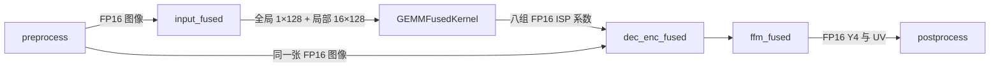

# 六算子 FP16 串联验证

编译机为每个算子生成一个 1952 静态 OM。用一个确定性的 1080×1920 测试样本生成整条 CPU golden。板端一次执行一个 OM，把返回的实板输出交给下一级，并逐级对比 CPU golden。



## 编译和出包

从 Pan-Boyi 的本地 `codex/1952-isp-chain` 分支使用 pypto-gym 和本部署仓。PyPTO 使用 `codex/1952-native-om` 的 `62956df3f`（含动态 shape 冻结和 DAV5102 mutex 适配），PTO-ISA 使用同名分支的 `62e98932`。环境准备与 PyPTO 源码安装见 [编译机环境](TRANSFORMER_ISP_1952.md#编译机出包)，其中源码分支和提交以上述版本为准。

激活编译环境，加载本机 CANN toolkit，在部署仓运行：

```bash
bash scripts/build_isp_chain.sh \
  --gym-root "$PYPTO_GYM_ROOT" \
  --toolkit-root "$CANN_SDK_ROOT" \
  --pto-root "$PTO_LIB_PATH" \
  --target-soc MC62CM12AA \
  --output "$PWD/out/isp-chain-01"
```

构建日志、ATC 审计和各 OM 位于输出目录。出包会核对 OM 的原生张量 ABI，并把六份 CPU case 的每条数据连接逐字节核对。把 `isp_chain.tar.gz` 与 `isp_chain.SHA256SUMS` 一起搬到板端。

## 板端执行

板端需要 Python 3.7.9+ 与机器自己的 AscendCL runtime。在新目录解压并校验：

```bash
sha256sum -c isp_chain.SHA256SUMS
tar -xzf isp_chain.tar.gz
bash isp_chain/run.sh --verify-only
```

选择一段测试，示例从 InputFused 开始到 FFM 结束：

```bash
bash isp_chain/run.sh --runtime-env /actual/board/set_env.sh \
  --start input_fused --end ffm_fused --device 0 --output /tmp/isp-input-to-ffm
```

只测 DecEnc：

```bash
bash isp_chain/run.sh --runtime-env /actual/board/set_env.sh \
  --start dec_enc_fused --end dec_enc_fused --device 0 --output /tmp/isp-dec-enc
```

省略 `--start/--end` 执行整段。板端环境已加载时可省略 `--runtime-env`。执行区间中的输入优先使用已运行算子的实板输出，区间外的前序输入使用同一串联 CPU case 的数据。例如从 InputFused 开始时，InputFused 和后面的 DecEnc 都使用打包的 preprocess golden 图像。从 preprocess 开始时，两处都使用其实际板端输出。

每个 OM 用两种哨兵预填输出，并各执行一次。结果目录的 `validation.json` 记录首个失败阶段和总结果。各算子子目录保留输入来源与哈希、执行日志、输出和逐张量误差。有限且完整的稳定输出即使超差也会传到下一级，以便看到后续误差。ACL 错误、未完整写入或非有限输出会中止链路。Postprocess 单测按零容差比较，在串联时额外对实际 FFM 的 Y4/UV 做零容差重排比较，其端到端比较沿用 FFM 的容差。

## GEMMFusedKernel 到 DecEnc

InputFused 的 `features[0:1]` 和 `features[1:17]` 分别给四路 global head 和四路 local head。GEMM 的 OM 将十个逻辑输出存到一个 FP16 `[68,16]`。DecEnc 接收下表八个连续 FP16 张量。下标从 0 开始，区间右端不含。

| GEMM 参数 | 打包行 | DecEnc 输入 | 形状 |
|---|---|---|---|
| Global WB | 0 | `channel_scale` | `[1,4,1,1]` |
| Global sigmoid×1.5 | 1 | `global_exponent` | `[1,1,1,1]` |
| Global center、contrast | 2，列 0、1 | `global_bias` | `[1,2,1,1]` |
| Global 4×4 matrix | 3 | `channel_mix` | `[1,4,4,1,1]` |
| Local WB | [4,20) | `tile_scale` | `[16,4,1,1]` |
| Local sigmoid×1.5 | [20,36) | `tile_exponent` | `[16,1,1,1]` |
| Local center、contrast | [36,52)，列 0、1 | `tile_bias` | `[16,2,1,1]` |
| Local 4×4 matrix | [52,68) | `tile_mix` | `[16,4,4,1,1]` |

GEMM 打包顺序是 `[center, contrast]`。桥接只把这两列重排成 DecEnc 接收的 FP16 `[contrast, center]`。DecEnc 的另外三个输入是 preprocess 图像、自身的 FP16 卷积权重和 INT32 Q16 bias。

DecEnc 在同一个 OM 内先对 preprocess 输出的 NCHW 图像计算均值，再执行亮度分支：

```python
gray = 0.299 * x[:, 0:1] + 0.587 * x[:, 1:2] + 0.587 * x[:, 2:3] + 0.114 * x[:, 3:4]
image_mean = gray.mean(dim=(2, 3), keepdim=True)
brightness = center + contrast * (x - image_mean)
```

全局和 16 个局部区域共用这一个整图均值，各自使用 GEMM 预测的 center 与 contrast。灰度乘法和加法的结果逐步舍入到 FP16。八个工作块用 FP32 累加部分和，归约后将均值写回 FP16。亮度分支依次执行 FP16 减法、乘法和加法。均值和部分和只在 DecEnc OM 内部传递。

验证用的是分别可执行的六个 OM。InputFused OM 内含 resize、encoder、reduce，GEMMFusedKernel OM 内含四个计算节点，DecEnc OM 内含灰度部分和、均值归约、ISP 与卷积三个节点。最新 FFM 直接用 FP16 head 输出做色彩投影。Postprocess 返回 FP16 NV12 排列样本。
