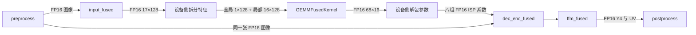

# 1952 FP16 ISP 单 OM 验证

编译机根据 `--start` 和 `--end` 生成一个 1952 静态 OM，包含两个端点及其之间的算子。整链图包含六个算子和两个设备侧布局转换节点。板端每轮只执行这个 OM，中间张量在设备 GM 交接，回读 `end` 的输出与同一条 1080×1920 CPU golden 链比较。



## 编译和出包

从 Pan-Boyi 的本地 `codex/1952-isp-chain` 分支使用 pypto-gym 和本部署仓。PyPTO 使用 `codex/1952-native-om` 的 `62956df3f`（含动态 shape 冻结和 DAV5102 mutex 适配），PTO-ISA 使用同名分支的 `62e98932`。环境准备与 PyPTO 源码安装见 [编译机环境](TRANSFORMER_ISP_1952.md#编译机出包)，其中源码分支和提交以上述版本为准。

激活编译环境，加载本机 CANN toolkit，在部署仓运行：

```bash
bash scripts/build_isp_chain.sh \
  --gym-root "$PYPTO_GYM_ROOT" \
  --toolkit-root "$CANN_SDK_ROOT" \
  --pto-root "$PTO_LIB_PATH" \
  --target-soc MC62CM12AA \
  --start preprocess --end postprocess \
  --output "$PWD/out/isp-chain-full"
```

默认区间为 `preprocess → postprocess`。指定 `--start input_fused --end ffm_fused` 会生成包含 InputFused、GEMM、DecEnc 和 FFM 的一个 OM。指定 `--start dec_enc_fused --end dec_enc_fused` 会生成只包含 DecEnc 的一个 OM。

出包会核对 OM 的原生张量 ABI 和区间输入输出。目录内的模型是 `isp_chain/model.om`，编译日志在 `build.log`，ATC 日志和审计在 `build_evidence/`。把 `isp_chain.tar.gz` 与 `isp_chain.SHA256SUMS` 一起搬到板端。

## 板端执行

板端需要 Python 3.7.9+ 与机器自己的 AscendCL runtime。在新目录解压并校验：

```bash
sha256sum -c isp_chain.SHA256SUMS
tar -xzf isp_chain.tar.gz
bash isp_chain/run.sh --verify-only
```

执行编译时选定的区间：

```bash
bash isp_chain/run.sh --runtime-env /actual/board/set_env.sh \
  --device 0 --output /tmp/isp-result
```

板端环境已加载时可省略 `--runtime-env`。板端也可传 `--start/--end` 校验包的端点。选择另一个区间时，在编译机用该区间重新出包。

区间外的前序结果由编译端 CPU golden 生成，并打包为外部输入。例如从 InputFused 开始时，InputFused 和 DecEnc 共用包里的一份 preprocess 图像。从 preprocess 开始时，两处共用它的设备 GM 输出。

测试用两种哨兵预填输出，每轮执行一次同一个 OM。`validation.json` 记录编译区间、OM 哈希和每个最终输出的误差。结果目录还保留 ACL 日志和两轮输出。单独验证 Postprocess 时使用零容差，区间内包含 FFM 时，NV12 的端到端比较沿用 FFM 容差。

## GEMMFusedKernel 到 DecEnc

InputFused 的 `features[0:1]` 和 `features[1:17]` 分别给四路 global head 和四路 local head。GEMM 的 OM 将十个逻辑输出存到一个 FP16 `[68,16]`。DecEnc 接收下表八个连续 FP16 张量。下标从 0 开始，区间右端不含。

| GEMM 参数 | 打包行 | DecEnc 输入 | 形状 |
|---|---|---|---|
| Global WB | 0 | `channel_scale` | `[1,4,1,1]` |
| Global sigmoid×1.5 | 1 | `global_exponent` | `[1,1,1,1]` |
| Global center、contrast | 2，列 0、1 | `global_bias` | `[1,2,1,1]` |
| Global 4×4 matrix | 3 | `channel_mix` | `[1,4,4,1,1]` |
| Local WB | [4,20) | `tile_scale` | `[16,4,1,1]` |
| Local sigmoid×1.5 | [20,36) | `tile_exponent` | `[16,1,1,1]` |
| Local center、contrast | [36,52)，列 0、1 | `tile_bias` | `[16,2,1,1]` |
| Local 4×4 matrix | [52,68) | `tile_mix` | `[16,4,4,1,1]` |

第 4、8 路对第二层 GEMM 加 bias 后的 16 个 FP16 值逐元素执行 `tanh`，按 4×4 排列，乘以 `0.15` 后加单位矩阵。

GEMM 打包顺序是 `[center, contrast]`。设备侧解包节点在 GM 中生成 DecEnc 接收的 FP16 `[contrast, center]`。DecEnc 的另外三个输入是 preprocess 图像、自身的 FP16 卷积权重和 INT32 Q16 bias。

DecEnc 在同一个 OM 内先对 preprocess 输出的 NCHW 图像计算均值，再执行亮度分支：

```python
gray = 0.299 * x[:, 0:1] + 0.587 * x[:, 1:2] + 0.587 * x[:, 2:3] + 0.114 * x[:, 3:4]
image_mean = gray.mean(dim=(2, 3), keepdim=True)
brightness = center + contrast * (x - image_mean)
```

全局和 16 个局部区域共用这一个整图均值，各自使用 GEMM 预测的 center 与 contrast。灰度乘法和加法的结果逐步舍入到 FP16。八个工作块用 FP32 累加部分和，归约后将均值写回 FP16。亮度分支依次执行 FP16 减法、乘法和加法。均值和部分和只在 DecEnc OM 内部传递。

InputFused 包含 resize、encoder、reduce 三个节点，GEMMFusedKernel 包含四个计算节点，DecEnc 包含灰度部分和、均值归约、ISP 与卷积三个节点。全区间 OM 共 15 个原生节点，含两个布局转换节点。FFM 直接用 FP16 head 输出做色彩投影，Postprocess 返回 FP16 NV12 排列样本。
